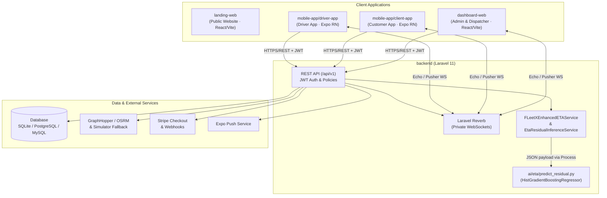

# FleetX System

**FleetX** is a multi-application logistics, fleet management, and real-time shipment operations platform. It unifies a Laravel 11 REST & WebSocket backend, a role-based Admin/Dispatcher web portal, a public marketing website, and dedicated Expo React Native mobile applications for Customers and Drivers—augmented by a Python-based machine learning residual ETA correction module.

> **Portfolio Notice:** This repository is a software engineering portfolio monorepo containing the source code and configuration templates for all five applications. It is intended for local development, architectural review, and academic/portfolio demonstration rather than turnkey production deployment.

---

## Table of Contents

- [Project Objectives](#project-objectives)
- [Architecture Overview](#architecture-overview)
- [Applications & Technology Stack](#applications--technology-stack)
- [Key Implemented Features](#key-implemented-features)
- [AI-Based ETA Module](#ai-based-eta-module)
- [Repository Structure](#repository-structure)
- [Prerequisites](#prerequisites)
- [Installation & Environment Setup](#installation--environment-setup)
- [Database Migrations & Seeding](#database-migrations--seeding)
- [Running Locally](#running-locally)
- [Testing & Verification](#testing--verification)
- [API Collection (Postman)](#api-collection-postman)
- [Security & Configuration Notes](#security--configuration-notes)

---

## Project Objectives

FleetX is designed to model and execute end-to-end freight and fleet operations across four distinct user roles (`admin`, `dispatcher`, `client`, and `driver`):

1. **Structured Order-to-Shipment Lifecycle:** Separate client shipment requests (drafts, submissions, change requests) from approved operational shipments, assignments, and route execution.
2. **Real-Time Operational Visibility:** Stream live driver telemetry, geofence/stage progression, and dispatch conversations over authenticated WebSocket channels.
3. **Verifiable Delivery Execution:** Enforce QR-based pickup/delivery verification, camera photo + signature Proof of Delivery (POD), PDF delivery certificates, and offline-resilient driver workflows.
4. **Data-Driven Safety & ETA Intelligence:** Evaluate driver telemetry for operational safety notices and performance scoring, and refine routing-engine ETAs using a trained ML residual model with deterministic fallback.
5. **Automated Billing & Pricing:** Support configurable pricing policies, operational variance rules, monthly invoicing, and Stripe Checkout payment fulfillment.

---

## Architecture Overview

FleetX follows a decoupled **client–server monorepo architecture** centered around a single authoritative Laravel 11 API and WebSocket server:



### Data Flow Highlights

- **Authentication:** All protected apps authenticate via `/api/v1/auth/*` using **JWT** (`php-open-source-saver/jwt-auth`) with refresh token support and role/policy gates.
- **Realtime Broadcasting:** Laravel Reverb authenticates private channels in `backend/routes/channels.php`:
  - `tracking.fleet`, `tracking.vehicle.{vehicleId}`, and `tracking.shipment.{shipmentId}` (restricted to internal operations roles via policies).
  - `conversation.{conversationId}` (restricted to conversation participants or authorized managers via `ConversationPolicy`).
- **Telemetry & Trip Execution:** The Driver App submits foreground GPS/speed telemetry while a trip is active, updating `TrackingLog` and `TrackingState`, triggering safety/evaluation checks, ETA recalculation, and broadcast updates.

---

## Applications & Technology Stack

### 1. Backend API (`backend/`)
- **Purpose:** Authoritative REST API, authentication, business domain actions/services, WebSocket broadcasting, PDF certificate generation, billing, and ML ETA orchestration.
- **Stack:** PHP `^8.2`, Laravel `^11.31`, `php-open-source-saver/jwt-auth` `^2.3`, Laravel Reverb `^1.11`, `stripe/stripe-php` `^21.3`, `barryvdh/laravel-dompdf` `^3.1`, PHPUnit `^11.0.1`, Laravel Pint, Vite/Tailwind (Laravel assets), Python 3 (`scikit-learn`, `pandas`, `numpy`, `joblib` for `ai/eta/`).

### 2. Admin & Dispatcher Dashboard (`dashboard-web/`)
- **Purpose:** Web operations console with separate role-scoped workspaces for **Admins** (companies, partner companies, drivers, vehicles, trailers, pricing policies, monthly invoices, read-only shipments/tracking) and **Dispatchers** (request intake/review/conversion, shipment & assignment operations, live fleet map, driver management, analytics, notifications, communications).
- **Stack:** React `19.2`, TypeScript `~6.0`, Vite `8.1`, Tailwind CSS `v4`, React Router `v7`, Axios, Laravel Echo + `pusher-js`, Leaflet + `react-leaflet`, Recharts, Framer Motion, Lucide React, `oxlint`.

### 3. Public Landing Website (`landing-web/`)
- **Purpose:** Public-facing product showcase and marketing site (`Hero`, `ProblemSection`, `SolutionSection`, `HowItWorksSection`, `FeatureSuite`, `RoleSuite`, `CommandCenter`, `TechSuite`, `MetricsSuite`, `Contact`).
- **Stack:** React `19.2`, TypeScript `~6.0`, Vite `8.1`, Tailwind CSS `v4`, React Router `v7`, Framer Motion, Recharts, Lucide React, `oxlint`.

### 4. Client Mobile Application (`mobile-app/client-app/`)
- **Purpose:** Cross-platform mobile/web app for customers to register/login, create and submit shipment requests with map location picking, track shipments, view QR codes and Proof of Delivery, message dispatch, receive notifications, and pay monthly invoices via Stripe.
- **Stack:** Expo `~56`, React Native `0.85`, Expo Router `~56`, React `19.2`, TypeScript `~6.0`, NativeWind `v4` / Tailwind CSS `v3`, `react-native-maps`, `react-native-qrcode-svg`, `expo-location`, `expo-secure-store`, Laravel Echo + `pusher-js`, Axios.

### 5. Driver Mobile Application (`mobile-app/driver-app/`)
- **Purpose:** Cross-platform mobile app for drivers to manage availability, accept and execute trip assignments, stream foreground telemetry, scan pickup/delivery QR codes, capture camera photos and digital signatures for POD, handle offline recovery/sync queues, view trip history/evaluations, and receive safety notices.
- **Stack:** Expo `~56`, React Native `0.85`, Expo Router `~56`, React `19.2`, TypeScript `~6.0`, NativeWind `v4` / Tailwind CSS `v3`, `expo-camera`, `expo-image-picker`, `expo-location`, `expo-notifications`, `expo-secure-store`, `@react-native-async-storage/async-storage`, `@react-native-community/netinfo`, Laravel Echo + `pusher-js`, Axios.

---

## Key Implemented Features

- **Role-Based Access & Multi-Role Isolation:** Distinct `admin`, `dispatcher`, `client`, and `driver` workflows enforced server-side via middleware and Laravel Policies.
- **Shipment Request & Conversion Workflow:** Draft creation, submission, dispatcher review/change requests, client resubmission, and atomic conversion from `ShipmentOrder` to `Shipment`.
- **Routing, Geofencing & Rerouting:** GraphHopper truck-profile routing with OSRM/simulator fallback, route deviation detection, dynamic rerouting, and operational rest-stop/geofence stage tracking.
- **Live Fleet Tracking & Messaging:** Real-time shipment/fleet state updates and participant-scoped dispatch messaging over Laravel Reverb.
- **Proof of Delivery (POD) & Certificates:** Pickup/delivery QR verification, photo + signature capture, and server-generated PDF delivery certificates (`barryvdh/laravel-dompdf`).
- **Driver Safety & Performance Scoring:** Operational safety notices for speed excess and harsh braking/sudden stops, plus modular assignment evaluation detectors (speeding, harsh braking/acceleration, sudden stop, idle stop, route deviation, timing, workflow) and driver score aggregation.
- **Pricing & Monthly Invoicing:** Configurable pricing policies and variance rules, monthly invoice generation, and Stripe Checkout session + webhook fulfillment (`StripePaymentService` includes a safe mock fallback when testing without live Stripe keys).

---

## AI-Based ETA Module

The ETA subsystem (`backend/app/Services/Eta/FLeetXEnhancedETAService.php` and `backend/app/Services/AI/Eta/`) enhances baseline routing ETAs using a **residual correction approach**:

1. **Baseline Calculation:** `FLeetXEnhancedETAService` computes `baseline_remaining_seconds` from live `remaining_distance_m` and configured cruise speed (default `80.0 km/h`).
2. **Feature Engineering & Validation:** `EtaFeatureBuilder` assembles a 22-feature payload (distance/progress metrics, coordinates, speed, heading, GPS accuracy, driver score/experience, vehicle/cargo weights, temporal features, `movement_status`, `cargo_type`, `baseline_routing_provider`, `temperature_controlled`, `hazardous_cargo`), validated by `EtaDataQualityMonitor` against `backend/ai/eta/models/feature_manifest.json`.
3. **ML Inference:** `EtaResidualInferenceService` invokes `backend/ai/eta/predict_residual.py` via Laravel `Process` with a temporary JSON payload. The script loads `eta_residual_model.joblib`—a `HistGradientBoostingRegressor` (`scikit-learn 1.7.1`, trained on `1,500` samples: `1,050` train / `225` val / `225` test per `model_metadata.json`)—to predict `residual_seconds`.
4. **Safe Fallback:** If AI ETA is disabled (`ai.eta.enabled`), model artifacts are missing, validation fails, or the Python process errors/times out, the service logs the condition and deterministically falls back to `baseline_remaining_seconds` (`SOURCE_BASELINE_ONLY`).

---

## Repository Structure

```text
FleetX System/
├── backend/                     # Laravel 11 API, Reverb WebSockets, migrations, tests & AI/ETA
│   ├── ai/eta/                  # Python residual ETA inference, training & evaluation scripts
│   ├── app/                     # Actions, Broadcasting, Domain, Enums, Http, Models, Policies, Services
│   ├── config/                  # Laravel & domain configuration files
│   ├── database/                # Factories, migrations & seeders
│   ├── routes/                  # api.php, channels.php, console.php, web.php
│   └── tests/                   # PHPUnit Unit & Feature test suites
├── dashboard-web/               # Admin & Dispatcher React/Vite web application
│   └── scripts/                 # Node-based verification scripts
├── landing-web/                 # Public marketing React/Vite web application
├── mobile-app/
│   ├── client-app/              # Expo React Native Customer app + verification scripts
│   ├── driver-app/              # Expo React Native Driver app + verification scripts
│   └── scripts/                 # Cross-app Playwright & ADB smoke scripts
├── postman/                     # Postman API collection & local environment template
├── .gitignore                   # Monorepo root ignore rules
├── fleetx_postman_collection.json
├── generate_fleetx_postman_collection.js
└── verify_fleetx_postman_collection.js
```

---

## Prerequisites

- **PHP** `>= 8.2` with required Laravel extensions (`mbstring`, `openssl`, `pdo`, `sqlite3`/`pgsql`/`mysql`, `gd` or `dompdf` dependencies) and **Composer**
- **Node.js** `>= 20` and **npm**
- **Python** `3.11+` with `pandas`, `numpy`, `scikit-learn`, and `joblib` (optional; only required if enabling AI residual ETA inference—backend safely falls back to baseline ETA if unavailable)
- **Expo CLI / Android Studio / Xcode** (for native mobile builds; web mode works via `expo start --web`)

---

## Installation & Environment Setup

### 1. Backend (`backend/`)

```bash
cd backend
composer install
npm install
cp .env.example .env
php artisan key:generate
php artisan jwt:secret
```

Review `backend/.env` and configure:
- **Database:** Defaults to `DB_CONNECTION=sqlite` (create an empty `database/database.sqlite` file if using SQLite, or configure PostgreSQL/MySQL).
- **Reverb WebSockets:** Set `REVERB_APP_ID`, `REVERB_APP_KEY`, and `REVERB_APP_SECRET` (must match the frontend/mobile `*_REVERB_APP_KEY`).
- **Optional Integrations:** `GRAPH_HOPPER_API_KEY` (falls back to simulator), `STRIPE_SECRET_KEY` & `STRIPE_WEBHOOK_SECRET` (uses mock checkout in testing/unconfigured mode), `EXPO_ACCESS_TOKEN` (for driver push).

### 2. Admin & Dispatcher Dashboard (`dashboard-web/`)

```bash
cd dashboard-web
npm install
cp .env.example .env
```

In `dashboard-web/.env`, ensure `VITE_API_BASE_URL` points to your backend (default `http://localhost:8000/api/v1`) and `VITE_REVERB_APP_KEY` / `VITE_PUSHER_APP_KEY` match `REVERB_APP_KEY` in `backend/.env`.

### 3. Public Landing Website (`landing-web/`)

```bash
cd landing-web
npm install
```

No environment variables are required for `landing-web`.

### 4. Client & Driver Mobile Apps (`mobile-app/`)

```bash
# Shared mobile E2E tooling (Playwright)
cd mobile-app
npm install

# Client App
cd client-app
npm install
cp .env.example .env

# Driver App
cd ../driver-app
npm install
cp .env.example .env
```

In both `client-app/.env` and `driver-app/.env`, set `EXPO_PUBLIC_API_BASE_URL` and `EXPO_PUBLIC_REVERB_HOST` to match your runtime target (`localhost` for web/iOS simulator, `10.0.2.2` for Android emulator, or your LAN IP for physical devices). For native Android Google Maps in `client-app`, set `EXPO_PUBLIC_GOOGLE_MAPS_API_KEY` before running `npm run android:dev`.

---

## Database Migrations & Seeding

From `backend/`:

```bash
# If using SQLite on Linux/macOS: touch database/database.sqlite
# On Windows PowerShell: New-Item -ItemType File -Path database/database.sqlite -Force

php artisan migrate
php artisan db:seed
```

`DatabaseSeeder` populates roles, statuses, vehicle/fuel types, payment methods, pricing policies, demo accounts, identity links, and master operational data.

---

## Running Locally

Open separate terminals (or use `backend`'s `composer dev` script for backend services):

1. **Backend API, Queue, Logs & Reverb WebSockets:**
   ```bash
   cd backend
   php artisan serve
   php artisan reverb:start
   # Optional: php artisan queue:listen --tries=1
   ```
   *(Alternatively, `composer dev` runs `serve`, `queue:listen`, `pail`, `npm run dev`, and `reverb:start` concurrently via `npx concurrently`.)*

2. **Admin & Dispatcher Dashboard:**
   ```bash
   cd dashboard-web
   npm run dev
   ```

3. **Landing Website:**
   ```bash
   cd landing-web
   npm run dev
   ```

4. **Client Mobile App:**
   ```bash
   cd mobile-app/client-app
   npm start          # or: npm run web | npm run android | npm run ios
   ```

5. **Driver Mobile App:**
   ```bash
   cd mobile-app/driver-app
   npm start          # or: npm run web | npm run android | npm run ios
   ```

---

## Testing & Verification

### Backend (PHPUnit)
```bash
cd backend
php artisan test
```
`phpunit.xml` configures `APP_ENV=testing`, `BROADCAST_CONNECTION=log`, and `DRIVER_PUSH_ENABLED=false` so tests run without an external Reverb server.

### Dashboard & Landing Web
```bash
cd dashboard-web
npm run lint
npm run build
# Feature/integration verification scripts:
npm run test:auth-session-lifecycle
npm run test:realtime-tracking-auth

cd ../landing-web
npm run lint
npm run build
```
*(See `dashboard-web/package.json` for the full list of `test:*` verification scripts.)*

### Mobile Apps
```bash
cd mobile-app/client-app
npm run typecheck
npm run lint
# Example milestone checks (see package.json for all scripts):
npm run test:c23-auth
npm run test:c58-client-security

cd ../driver-app
npm run typecheck
npm run lint
# Example milestone checks (see package.json for all scripts):
npm run test:driver-auth
npm run test:driver-boundary
```

---

## API Collection (Postman)

Postman artifacts are located in `postman/`:
- `postman/FLeetX-API-Collection.json` — API endpoint collection
- `postman/FLeetX-Local-Environment.json` — Local environment template (`base_url`, `api_url`, and empty token/ID variables populated during requests)

---

## Security & Configuration Notes

- **Never commit `.env` files:** All `.env` and `.env.*` files are excluded by `.gitignore`; only sanitized `.env.example` templates are tracked.
- **Server-Only Secrets:** Keep `APP_KEY`, `JWT_SECRET`, `STRIPE_SECRET_KEY`, `STRIPE_WEBHOOK_SECRET`, `GRAPH_HOPPER_API_KEY`, `REVERB_APP_SECRET`, and `EXPO_ACCESS_TOKEN` strictly on the backend. Never expose them in `VITE_*` or `EXPO_PUBLIC_*` client variables.
- **Mobile Transport Security:** In `mobile-app/client-app/app.config.js` and `mobile-app/driver-app/app.config.js`, cleartext HTTP is permitted only in non-production builds. Setting `EXPO_PUBLIC_ENV=production` enforces HTTPS-only transport.
- **Channel Authorization:** All WebSocket channels are private and policy-gated (`backend/routes/channels.php`); clients cannot subscribe to internal `tracking.*` channels.

